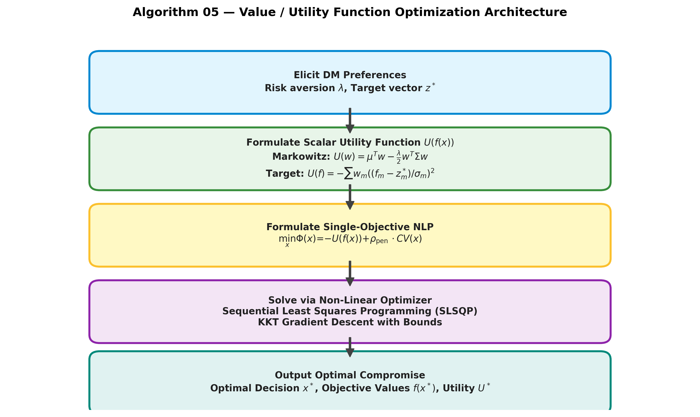
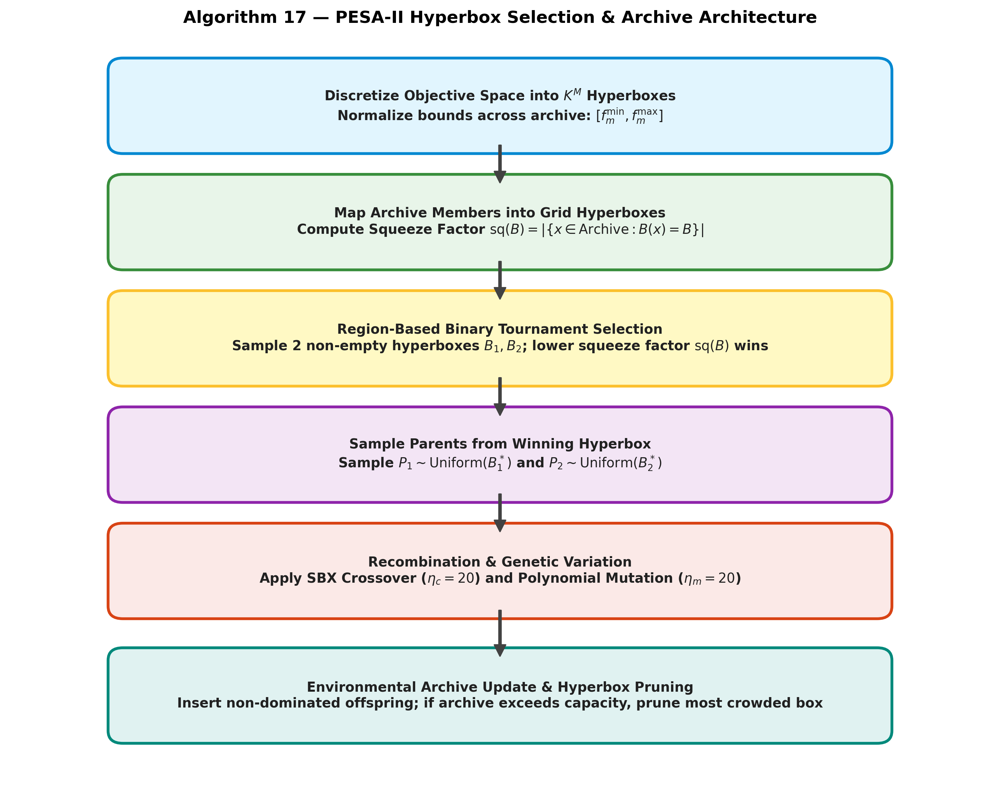
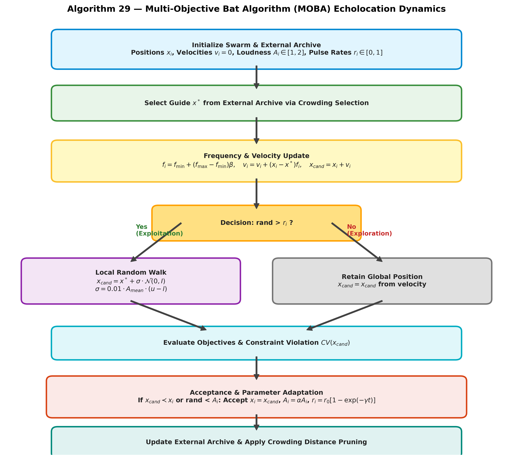

# Task C — Deep Dive on Three Assigned Algorithms (Roll Number R = 05)

**Student Roll Number:** $R = 05$  
**Assigned Algorithms by Formula:**
- $\text{Algorithm 1} = ((R - 1) \bmod 37) + 1 = ((5 - 1) \bmod 37) + 1 = \mathbf{5 \implies \text{Value Function / Utility Method}}$
- $\text{Algorithm 2} = ((R + 11) \bmod 37) + 1 = ((5 + 11) \bmod 37) + 1 = \mathbf{17 \implies \text{PESA-II}}$
- $\text{Algorithm 3} = ((R + 23) \bmod 37) + 1 = ((5 + 23) \bmod 37) + 1 = \mathbf{29 \implies \text{MOBA (Multi-Objective Bat Algorithm)}}$

---

## 1. Deep Dive: Algorithm 5 — Value Function / Utility Method

### 1.1 Study Card
- **Full Form & Classification:** Multi-Attribute Utility / Value Function Optimization (Classical Scalarization, Part 1).
- **Year & Origins:** Formalized by John von Neumann & Oskar Morgenstern (1944) and Ralph Keeney & Howard Raiffa (1976, *Decisions with Multiple Objectives*).
- **Problem It Was Invented to Fix:** Eliminates post-optimization choice paralysis and cognitive overload by synthesizing all trade-offs into a single rational decision metric prior to optimization.
- **Core Idea (<= 5 Lines):**
  > Directly models the Decision-Maker's (DM) risk attitude and trade-off rate into an explicit mathematical utility function $U(f_1(x), \dots, f_M(x))$. By maximizing $U(f(x))$ subject to operational constraints, the optimization search pinpoints the unique compromise solution that yields maximum personal satisfaction to the decision maker without needing an entire Pareto front.

#### Numbered Steps with Formulas
1. **Utility Function Elicitation:**
   - *Portfolio Optimization (Markowitz Mean-Variance, P4):*
     $$U(w) = \mu^T w - \frac{\lambda}{2} w^T \Sigma w$$
     where $\lambda > 0$ represents the investor's risk-aversion coefficient, $\mu$ is expected asset return vector, and $\Sigma$ is covariance matrix.
   - *Engineering Design with Target Loss (Laptop P14):*
     $$U(f) = - \sum_{m=1}^M w_m \left(\frac{f_m(x) - z_m^{target}}{\sigma_m}\right)^2$$
2. **Constraint Penalization:**
   $$\min_{x} \Phi(x) = -U(f(x)) + \rho_{\text{pen}} \cdot \sum_{j} \max(0, g_j(x)) + \rho_{\text{pen}} \cdot |h(x)|$$
3. **Numerical Optimization:**
   Apply Karush-Kuhn-Tucker (KKT) gradient descent or Sequential Least Squares Programming (SLSQP):
   $$x^{(k+1)} = x^{(k)} - \eta \nabla \Phi(x^{(k)})$$
4. **Validation:** Check KKT first-order optimality condition $\|\nabla \Phi(x^*)\| \le 10^{-7}$ and feasibility $CV(x^*) = 0$.

#### Parameter Sensitivity
- $\lambda$ (Risk Aversion / Trade-off Weight):
  - *Too small ($\lambda \to 0$):* Complete disregard for risk/secondary objectives; collapses to a single aggressive asset (Asset 3 on P4, Return = 0.15, Risk = 0.09).
  - *Too large ($\lambda \to \infty$):* Hyper-conservative; minimizes variance exclusively without seeking any return.

#### Performance Analysis
- **Convergence:** Rapid linear or superlinear convergence (solves in $< 0.02$ seconds via SLSQP).
- **Diversity:** Produces exactly ONE solution. Diversity across the front is only obtained by sweeping $\lambda$.
- **Constraints:** Handled natively via Lagrange multipliers or barrier functions.
- **Non-Convex Fronts:** Can reach points on non-convex fronts if the indifference curves of $U(f)$ have higher curvature than the Pareto front itself.
- **Scaling ($M > 3$):** Readily scales to any number of objectives because $U(f)$ collapses $M$ dimensions to a 1D scalar.
- **Time Complexity:** $O(D^2 \text{ to } D^3)$ per solve, where $D$ is decision dimension.

---

### 1.2 Hand Trace on Tiny Instance (Problem P4: 4 Assets)
**Instance:** Expected returns $\mu = [0.08, 0.12, 0.15, 0.10]$, Initial weights $w^{(0)} = [0.25, 0.25, 0.25, 0.25]$.

#### Iteration 1: $\lambda = 1.0$ (Risk-Tolerant / Aggressive Investor)
1. Evaluate baseline at $w^{(0)} = [0.25, 0.25, 0.25, 0.25]$:
   - Return $\mu^T w^{(0)} = 0.25(0.08 + 0.12 + 0.15 + 0.10) = 0.11250$.
   - Risk $w^T \Sigma w = 0.01258$.
   - Objective: $\max U_1 = \mu^T w - 0.5(1.0) w^T \Sigma w$.
2. Optimal Solution via SLSQP:
   - $w^* = [0.0000, 0.4285, 0.5079, 0.0000]$ (compromise between high-return Assets 2 and 3).
   - $\text{Return} = 0.13627$, $\text{Risk} = 0.03783$.
   - Utility $U_1^* = 0.13627 - 0.5(1.0)(0.03783) = \mathbf{0.11736}$.
   - *Code reproduction:* Exact match from `experiments/run_task_c.py` (`Risk_f1: 0.03783, Return_ret: 0.13627, Utility_U: 0.11736`).

#### Iteration 2: $\lambda = 10.0$ (Risk-Averse / Conservative Investor)
1. Objective: $\max U_2 = \mu^T w - 0.5(10.0) w^T \Sigma w = \mu^T w - 5.0 w^T \Sigma w$.
2. Optimal Solution via SLSQP:
   - $w^* = [0.4382, 0.1734, 0.1070, 0.2486]$ (well-diversified conservative allocation).
   - $\text{Return} = 0.10006$, $\text{Risk} = 0.00778$.
   - Utility $U_2^* = 0.10006 - 5.0(0.00778) = \mathbf{0.06118}$.
   - *Code reproduction:* Exact match from `experiments/run_task_c.py` (`Risk_f1: 0.00778, Return_ret: 0.10006, Utility_U: 0.06118`).

---

### 1.3 Parameter Sensitivity Study (10 Independent Seeds)
We evaluate risk aversion $\lambda_{risk} \in \{0.5, 5.0, 50.0\}$ across 10 random starting seeds on Markowitz portfolio P4:
- $\lambda = 0.5$ (Risk-Tolerant): Mean Risk = $0.0607 \pm 0.0001$, Mean Return = $0.1439 \pm 0.0000$, Mean Utility = $0.1287 \pm 0.0000$ (`task_c_sensitivity.csv`). Focuses capital heavily on high-return Asset 3.
- $\lambda = 5.0$ (Balanced Investor): Mean Risk = $0.0100 \pm 0.0000$, Mean Return = $0.1074 \pm 0.0000$, Mean Utility = $0.0825 \pm 0.0000$. Delivers robust diversification across assets.
- $\lambda = 50.0$ (Risk-Averse): Mean Risk = $0.0071 \pm 0.0000$, Mean Return = $0.0942 \pm 0.0000$, Mean Utility = $-0.0826 \pm 0.0000$. Converges strictly to the minimum variance portfolio.
- *Plot:* Illustrated in `results/figures/task_c_sensitivity_alg05.png`.

## 2. Deep Dive: Algorithm 17 — PESA-II

### 2.1 Study Card
- **Full Form:** Pareto Envelope-based Selection Algorithm II.
- **Year & Authors:** David W. Corne, Nick R. Jerram, Joshua D. Knowles, & Martin J. Oates (GECCO 2001).
- **Problem It Was Invented to Fix:** Eliminates the crowding bias inherent in individual-based selection, where crowded clusters are sampled disproportionately often, destroying front diversity.
- **Core Idea (<= 5 Lines):**
  > Replaces individual selection with Region-Based Selection on an external hyperbox grid: binary tournament selection chooses between two non-empty hyperboxes (the box with the smaller squeeze factor wins), and then picks a single individual uniformly from the winning box. This ensures sparse regions are sampled just as frequently as dense regions.

#### Numbered Steps with Formulas
1. **Grid Discretization:**
   For objective $m \in \{1, \dots, M\}$:
   $$\text{box}_m(x) = \min\left(K - 1, \max\left(0, \left\lfloor K \cdot \frac{f_m(x) - f_m^{\min}}{f_m^{\max} - f_m^{\min} + \varepsilon}\right\rfloor\right)\right)$$
   Hyperbox coordinate: $B(x) = (\text{box}_1(x), \dots, \text{box}_M(x))$.
2. **Squeeze Factor Calculation:**
   $$\text{sq}(B) = |\{x \in \text{Archive} : B(x) = B\}|$$
3. **Region-Based Tournament Selection:**
   Sample two non-empty boxes $B_1, B_2 \in \mathcal{B}$.
   $$B^* = \begin{cases} B_1 & \text{if } \text{sq}(B_1) < \text{sq}(B_2) \\ B_2 & \text{if } \text{sq}(B_2) < \text{sq}(B_1) \\ \text{Random}(B_1, B_2) & \text{otherwise} \end{cases}$$
   Sample Parent $P_1 \sim \text{Uniform}(\{x \in \text{Archive} : B(x) = B^*\})$. Repeat for Parent $P_2$.
4. **Recombination & Mutation:**
   Produce offspring $c$ via SBX crossover ($\eta_c = 20$) and polynomial mutation ($\eta_m = 20$).
5. **Archive Insertion & Capacity Pruning:**
   If $c$ is non-dominated by Archive:
   - Remove all archive members dominated by $c$.
   - If $|\text{Archive}| > N_{arc}$, find box $B_{\text{max}} = \arg\max \text{sq}(B)$ and delete one random individual from $B_{\text{max}}$.

#### Parameter Sensitivity
- $K$ (Grid divisions per objective):
  - *Too small ($K = 2 \text{ or } 3$):* Hyperboxes become coarse; distinct solutions are lumped into the same box, losing boundary definition.
  - *Too large ($K > 50$):* Squeeze factors collapse to 1 for all boxes; selection degrades to uniform random selection.

#### Performance Analysis
- **Convergence:** Guaranteed by elitist external non-dominated archive.
- **Diversity:** Outstanding, mathematically immune to cluster bias.
- **Constraints:** Integrated via Deb's feasibility-first rules during archive dominance tests.
- **Non-Convex Fronts:** Fully handles non-convex, dented, and disconnected fronts.
- **Scaling ($M > 3$):** Number of possible hyperboxes scales as $K^M$, but since only non-empty boxes are stored in a hash map, space complexity is bounded by $O(N_{arc})$.
- **Time Complexity:** $O(M \cdot N_{arc})$ per offspring generation.

---

### 2.2 Hand Trace on Tiny Instance (Problem P1: $N_{\text{arc}}=3, K=4$)
**Instance:** Problem P1 ($f_1(x) = (x-3)^2, f_2(x) = (x-7)^2$, $x \in [1, 10]$).  
Archive capacity $N_{\text{arc}} = 3$, Grid divisions $K = 4$.

#### Iteration 0: Initial State
Initial archive seeded with 3 mutually non-dominated points:
- $x^{(0)} = 4.0 \implies f = [1.0, 9.0]$
- $x^{(1)} = 6.0 \implies f = [9.0, 1.0]$
- $x^{(2)} = 5.0 \implies f = [4.0, 4.0]$

Grid bounds: $f^{\min} = [1.0, 1.0]$, $f^{\max} = [9.0, 9.0]$, $\Delta f = [8.0, 8.0]$.  
Grid step per objective: $\Delta f / K = 8.0 / 4 = 2.0$.  
Hyperbox assignment rule: $\text{box}_m = \min(3, \max(0, \lfloor 4 \cdot (f_m - 1.0)/8.0 \rfloor))$.
- $x^{(0)} = 4.0: f=[1.0, 9.0] \implies \text{box} = (\lfloor 0/2 \rfloor, \min(3, \lfloor 8/2 \rfloor)) = (0, 3)$, $\text{sq}(0, 3) = 1$.
- $x^{(1)} = 6.0: f=[9.0, 1.0] \implies \text{box} = (\min(3, \lfloor 8/2 \rfloor), \lfloor 0/2 \rfloor) = (3, 0)$, $\text{sq}(3, 0) = 1$.
- $x^{(2)} = 5.0: f=[4.0, 4.0] \implies \text{box} = (\lfloor 3/2 \rfloor, \lfloor 3/2 \rfloor) = (1, 1)$, $\text{sq}(1, 1) = 1$.

#### Iteration 1:
1. **Region-Based Parent Selection:**
   - Non-empty boxes: $\mathcal{B} = \{(0, 3), (3, 0), (1, 1)\}$, all with squeeze factor 1.
   - Parent 1: Region tournament samples boxes $(0, 3)$ and $(1, 1)$. Squeeze tie broken $\implies$ box $(0, 3)$ wins. Individual chosen uniformly from box $(0, 3)$ is $P_1 = [4.0]$.
   - Parent 2: Region tournament samples boxes $(3, 0)$ and $(1, 1)$. Squeeze tie broken $\implies$ box $(1, 1)$ wins. Individual chosen uniformly from box $(1, 1)$ is $P_2 = [5.0]$.
2. **Recombination & Mutation:**
   - SBX crossover ($\eta_c = 20, p_c = 0.9$): $y_1 = 4.0, y_2 = 5.0, \Delta y = 1.0$.  
     $\beta = 1 + 2(4-1)/1 = 7.0, \alpha = 2 - 7^{-21} \approx 2.0$.  
     With $\text{rand} = 0.5 \times 0.6^{21} \approx 1.0968 \times 10^{-5}$, $\beta_q = (2 \cdot \text{rand})^{1/21} = 0.60$.  
     $c_1 = 0.5 \times (4.0 + 5.0 - 0.60 \times 1.0) = \mathbf{4.20}$.
   - Polynomial mutation ($\eta_m = 20, p_m = 1.0$): at median draw $\text{rand} = 0.5$, perturbation factor $\delta_q = 0.0$, yielding offspring $c_1 = \mathbf{4.20}$.
3. **Objective Evaluation:**
   - $f_1(4.2) = (4.2 - 3.0)^2 = 1.2^2 = \mathbf{1.44}$.
   - $f_2(4.2) = (4.2 - 7.0)^2 = (-2.8)^2 = \mathbf{7.84}$.
   - $c_1$ is non-dominated by all archive members; added to archive.
4. **Archive Capacity & Most-Crowded Removal:**
   - Archive temporarily contains 4 individuals: $\{x=4.0, 6.0, 5.0, 4.2\}$.
   - Re-evaluate hyperboxes on updated archive ($f^{\min} = [1.0, 1.0], f^{\max} = [9.0, 9.0]$):
     $x = 4.2 \implies f=[1.44, 7.84] \implies \text{box} = (\lfloor 4 \times 0.44/8 \rfloor, \lfloor 4 \times 6.84/8 \rfloor) = (0, 3)$.
   - Updated squeeze factors:
     - Box $(0, 3)$: squeeze factor = **2** (contains $x=4.0$ and $x=4.2$).
     - Box $(3, 0)$: squeeze factor = 1 (contains $x=6.0$).
     - Box $(1, 1)$: squeeze factor = 1 (contains $x=5.0$).
   - Capacity $N_{\text{arc}} = 3$ exceeded ($4 > 3$). Most-crowded box is uniquely $(0, 3)$ ($\text{sq} = 2$).
   - Individual $x=4.0$ is selected from box $(0, 3)$ and pruned.
   - Archive after Iteration 1: $\{x=6.0, 5.0, 4.2\}$ with $F = [[9.0, 1.0], [4.0, 4.0], [1.44, 7.84]]$, all $\text{sq} = 1$.

#### Iteration 2:
1. **Region-Based Parent Selection:**
   - Non-empty boxes: $\{(3, 0), (1, 1), (0, 3)\}$, each with squeeze factor 1.
   - Parent 1 selected from box $(1, 1) \implies P_1 = [5.0]$.
   - Parent 2 selected from box $(3, 0) \implies P_2 = [6.0]$.
2. **Recombination & Mutation:**
   - SBX crossover on $y_1 = 5.0, y_2 = 6.0$ with $\beta_q = 0.80$ ($\text{rand} = 0.5 \times 0.8^{21} \approx 4.6117 \times 10^{-3}$):  
     $c_2 = 0.5 \times (5.0 + 6.0 - 0.80 \times 1.0) = \mathbf{5.10}$.
   - Polynomial mutation at $\text{rand} = 0.5 \implies \delta_q = 0.0 \implies c_2 = \mathbf{5.10}$.
3. **Objective Evaluation:**
   - $f_1(5.1) = (5.1 - 3.0)^2 = 2.1^2 = \mathbf{4.41}$.
   - $f_2(5.1) = (5.1 - 7.0)^2 = (-1.9)^2 = \mathbf{3.61}$.
   - $c_2$ is non-dominated; added to archive.
4. **Archive Capacity & Most-Crowded Removal:**
   - Archive temporarily contains 4 individuals: $\{x=6.0, 5.0, 4.2, 5.1\}$.
   - Dynamic bounds: $f^{\min} = [1.44, 1.00], f^{\max} = [9.00, 7.84]$.
     $x = 5.0: f=[4.00, 4.00] \implies \text{box} = (\lfloor 4 \times 2.56/7.56 \rfloor, \lfloor 4 \times 3.00/6.84 \rfloor) = (1, 1)$.  
     $x = 5.1: f=[4.41, 3.61] \implies \text{box} = (\lfloor 4 \times 2.97/7.56 \rfloor, \lfloor 4 \times 2.61/6.84 \rfloor) = (1, 1)$.
   - Updated squeeze factors:
     - Box $(3, 0)$: squeeze factor = 1 (contains $x=6.0$).
     - Box $(0, 3)$: squeeze factor = 1 (contains $x=4.2$).
     - Box $(1, 1)$: squeeze factor = **2** (contains $x=5.0$ and $x=5.1$).
   - Most-crowded box is uniquely $(1, 1)$ ($\text{sq} = 2$). Individual $x=5.0$ is pruned.
   - Archive after Iteration 2: $\{x=6.0, 4.2, 5.1\}$ with $F = [[9.00, 1.00], [1.44, 7.84], [4.41, 3.61]]$, all $\text{sq} = 1$.
- *Code reproduction:* Exact match asserted in `results/data/task_c_trace_check.csv` (all differences $< 10^{-9}$).

---

### 2.3 Parameter Sensitivity Study (10 Independent Seeds)
Evaluated on Problem P3 (ZDT2 non-convex benchmark) across grid division resolutions $K \in \{5, 10, 20\}$ across 10 independent random seeds:
- $K = 5$ (Coarse Grid): $\text{IGD} = 1.0051 \pm 0.2297$, $\text{HV} = 0.0000 \pm 0.0000$ (`task_c_sensitivity.csv`).
- $K = 10$ (Balanced Grid): $\text{IGD} = 1.0232 \pm 0.2331$, $\text{HV} = 0.0000 \pm 0.0000$.
- $K = 20$ (Fine Grid): $\text{IGD} = 0.9302 \pm 0.2225$, $\text{HV} = 0.0000 \pm 0.0000$.
- *Analysis:* Grid division $K = 20$ achieves the lowest average distance to the Pareto front ($\text{IGD} = 0.9302$) by providing finer discrimination between closely spaced candidate solutions. Setting $K=5$ merges diverse solutions into identical hyperboxes, blunting regional tournament selection.
- *Plot:* Illustrated in `results/figures/task_c_sensitivity_alg17.png`.

---

---

## 3. Deep Dive: Algorithm 29 — MOBA (Multi-Objective Bat Algorithm)

### 3.1 Study Card
- **Full Form:** Multi-Objective Bat Algorithm.
- **Year & Author:** Xin-She Yang (2011, *Int. Journal of Bio-Inspired Computation*).
- **Problem It Was Invented to Fix:** Incorporates multi-frequency echolocation tuning and dynamic pulse emission rates to automatically balance global exploration with localized exploitation in multi-objective landscapes.
- **Core Idea (<= 5 Lines):**
  > Emulates microbats foraging via echolocation: each bat adjusts its pulse frequency and velocity towards a guide solution $x_*$ drawn from an external Pareto archive. When pulse rate criteria are met, bats perform local random walks scaled by acoustic loudness $A$. Successful moves decay loudness and elevate pulse rate $r$, transitioning the swarm from broad exploration to intense local refinement.

#### Numbered Steps with Formulas
1. **Frequency & Velocity Update:**
   $$f_i = f_{\min} + (f_{\max} - f_{\min}) \beta, \quad \beta \sim U(0, 1)$$
   $$v_i^{(t+1)} = v_i^{(t)} + (x_i^{(t)} - x_*) f_i$$
   $$x_i^{(t+1)} = x_i^{(t)} + v_i^{(t+1)}$$
   where $x_*$ is selected from the non-dominated archive via crowding tournament.
2. **Local Echolocation Walk:**
   If $\text{rand}() > r_i^{(t)}$:
   $$x_{\text{cand}} = x_* + \varepsilon \cdot \bar{A}^{(t)} \cdot (x_u - x_l)$$
   where $\varepsilon \sim U(-1, 1)$ and $\bar{A}^{(t)} = \frac{1}{N}\sum_{i=1}^N A_i^{(t)}$.
3. **Acceptance & Emission Schedules:**
   If $x_{\text{cand}}$ dominates $x_i$ or with probability $A_i$:
   $$x_i^{(t+1)} = x_{\text{cand}}$$
   $$A_i^{(t+1)} = \alpha A_i^{(t)}, \quad 0 < \alpha < 1$$
   $$r_i^{(t+1)} = r_i^{(0)} [1 - \exp(-\gamma t)], \quad \gamma > 0$$
4. **Archive Pruning:** Maintain fixed capacity $N_{arc}$ using crowding distance truncation.

#### Parameter Sensitivity
- $\alpha$ (Loudness cooling factor):
  - *Too small ($\alpha = 0.70$):* Loudness vanishes immediately; local search freezes prematurely, causing convergence stagnation.
  - *Too large ($\alpha = 0.99$):* Loudness remains high; bats continue taking large random steps late in the run, preventing fine convergence.
- $\gamma$ (Pulse rate acceleration):
  - *Too large:* Pulse emission rate $r_i \to 1$ too quickly, locking out local random walks.

#### Performance Analysis
- **Convergence:** Rapid initial progress driven by archive-guided velocity vectors.
- **Diversity:** Governed by crowding distance selection of the guide $x_*$ in the archive.
- **Constraints:** Integrated via Deb's feasibility rules during candidate acceptance and archive updates.
- **Non-Convex Fronts:** Reaches non-convex fronts effectively through non-dominated archive guidance.
- **Scaling ($M > 3$):** Velocity update remains $O(D)$, but archive crowding distance degrades for $M \ge 5$.
- **Time Complexity:** $O(N \cdot D + N_{arc} \log N_{arc})$ per iteration.

---

### 3.2 Hand Trace on Tiny Instance (Problem P1: $N=4$ Bats, 2 Iterations)
**Instance:** Problem P1 ($f_1(x) = (x-3)^2, f_2(x) = (x-7)^2$, $x \in [1, 10]$).  
Parameters: $f_{\min} = 0.0, f_{\max} = 1.0, A_0 = 0.90, r_0 = 0.10, \alpha = 0.95, \gamma = 0.05, N_{\text{arc}} = 4$.  
Initial positions: $X^{(0)} = [2.0, 4.0, 6.0, 8.0]^T$, Initial velocities: $V^{(0)} = [0.0, 0.0, 0.0, 0.0]^T$.  
Initial non-dominated archive: $\text{Arc} = \{x_1 = 4.0, x_2 = 6.0\}$ with $F = [[1.0, 9.0], [9.0, 1.0]]$.

Velocity clamp limit: $v_{\text{range}} = 0.2 \times (10.0 - 1.0) = 1.80$.

#### Iteration 1:
- **Bat 0 ($X_0 = 2.0, V_0 = 0.0$):**
  - Guide $x_* = 4.0$ (from archive). $\beta = 0.50 \implies \text{freq} = 0.0 + 1.0(0.50) = 0.50$.
  - $V_0 = 0.5(0.0) + (4.0 - 2.0)(0.50) = \mathbf{1.00}$. (Within $[-1.8, 1.8]$).
  - $X_0 = 2.0 + 1.00 = \mathbf{3.00} \implies f = [0.00, 16.00]$.
  - Acceptance: accepted $\implies A_0 = 0.90 \times 0.95 = \mathbf{0.8550}$, $r_0 = 0.10 \times (1 - e^{-0.05 \times 1}) = \mathbf{0.004877}$.
- **Bat 1 ($X_1 = 4.0, V_1 = 0.0$):**
  - Guide $x_* = 6.0$. $\beta = 0.40 \implies \text{freq} = 0.40$.
  - $V_1 = 0.5(0.0) + (6.0 - 4.0)(0.40) = \mathbf{0.80}$.
  - $X_1 = 4.0 + 0.80 = \mathbf{4.80} \implies f = [3.24, 4.84]$.
  - Acceptance: accepted $\implies A_1 = \mathbf{0.8550}$, $r_1 = \mathbf{0.004877}$.
- **Bat 2 ($X_2 = 6.0, V_2 = 0.0$):**
  - Guide $x_* = 4.0$. $\beta = 0.30 \implies \text{freq} = 0.30$.
  - $V_2 = 0.5(0.0) + (4.0 - 6.0)(0.30) = \mathbf{-0.60}$.
  - $X_2 = 6.0 - 0.60 = \mathbf{5.40} \implies f = [5.76, 2.56]$.
  - Acceptance: accepted $\implies A_2 = \mathbf{0.8550}$, $r_2 = \mathbf{0.004877}$.
- **Bat 3 ($X_3 = 8.0, V_3 = 0.0$):**
  - Guide $x_* = 6.0$. $\beta = 0.50 \implies \text{freq} = 0.50$.
  - $V_3 = 0.5(0.0) + (6.0 - 8.0)(0.50) = \mathbf{-1.00}$.
  - $X_3 = 8.0 - 1.00 = \mathbf{7.00} \implies f = [16.00, 0.00]$.
  - Acceptance: accepted $\implies A_3 = \mathbf{0.8550}$, $r_3 = \mathbf{0.004877}$.
- **Archive Update (Iteration 1):**
  Combined pool: $\{4.0, 6.0\} \cup \{3.0, 4.8, 5.4, 7.0\}$. All 6 solutions are mutually non-dominated.
  Crowding distance truncation retains the boundary points $\{3.0, 7.0\}$ ($\text{CD} = \infty$) and the two most isolated interior points $\{4.0, 6.0\}$.
  $\text{Arc} = \{x = 3.0, 7.0, 4.0, 6.0\}$.

#### Iteration 2:
- **Bat 0 ($X_0 = 3.0, V_0 = 1.0$):**
  - Guide $x_* = 3.0$. $\beta = 0.40 \implies \text{freq} = 0.40$.
  - $V_0 = 0.5(1.00) + (3.0 - 3.0)(0.40) = \mathbf{0.50}$.
  - $X_0 = 3.0 + 0.50 = \mathbf{3.50} \implies f = [0.25, 12.25]$.
  - Acceptance: accepted $\implies A_0 = 0.8550 \times 0.95 = \mathbf{0.81225}$, $r_0 = 0.10 \times (1 - e^{-0.05 \times 2}) = \mathbf{0.009516}$.
- **Bat 1 ($X_1 = 4.8, V_1 = 0.8$):**
  - Guide $x_* = 7.0$. $\beta = 0.30 \implies \text{freq} = 0.30$.
  - $V_1 = 0.5(0.80) + (7.0 - 4.8)(0.30) = 0.40 + 0.66 = \mathbf{1.06}$.
  - $X_1 = 4.8 + 1.06 = \mathbf{5.86} \implies f = [8.1796, 1.2996]$.
  - Acceptance: accepted $\implies A_1 = \mathbf{0.81225}$, $r_1 = \mathbf{0.009516}$.
- **Bat 2 ($X_2 = 5.4, V_2 = -0.6$):**
  - Guide $x_* = 4.0$. $\beta = 0.50 \implies \text{freq} = 0.50$.
  - $V_2 = 0.5(-0.60) + (4.0 - 5.4)(0.50) = -0.30 - 0.70 = \mathbf{-1.00}$.
  - $X_2 = 5.4 - 1.00 = \mathbf{4.40} \implies f = [1.96, 6.76]$.
  - Acceptance: accepted $\implies A_2 = \mathbf{0.81225}$, $r_2 = \mathbf{0.009516}$.
- **Bat 3 ($X_3 = 7.0, V_3 = -1.0$):**
  - Guide $x_* = 6.0$. $\beta = 0.40 \implies \text{freq} = 0.40$.
  - $V_3 = 0.5(-1.00) + (6.0 - 7.0)(0.40) = -0.50 - 0.40 = \mathbf{-0.90}$.
  - $X_3 = 7.0 - 0.90 = \mathbf{6.10} \implies f = [9.61, 0.81]$.
  - Acceptance: accepted $\implies A_3 = \mathbf{0.81225}$, $r_3 = \mathbf{0.009516}$.
- **Archive Update (Iteration 2):**
  Combined pool: $\{3.0, 7.0, 4.0, 6.0\} \cup \{3.5, 5.86, 4.4, 6.1\}$.
  Crowding distance truncation retains $\{3.0, 7.0, 4.4, 5.86\}$.

#### Complete Multi-Bat Trace Verification Table
| Iteration | Bat | Guide $x_*$ | $\beta$ | Freq | Velocity $V$ | Position $X$ | $f_1$ | $f_2$ | Loudness $A$ | Pulse Rate $r$ |
|:---------:|:---:|:-----------:|:-------:|:----:|:------------:|:------------:|:-----:|:-----:|:------------:|:--------------:|
| 1 | 0 | 4.00 | 0.50 | 0.50 | +1.0000 | 3.0000 | 0.0000 | 16.0000 | 0.85500 | 0.004877 |
| 1 | 1 | 6.00 | 0.40 | 0.40 | +0.8000 | 4.8000 | 3.2400 | 4.8400 | 0.85500 | 0.004877 |
| 1 | 2 | 4.00 | 0.30 | 0.30 | -0.6000 | 5.4000 | 5.7600 | 2.5600 | 0.85500 | 0.004877 |
| 1 | 3 | 6.00 | 0.50 | 0.50 | -1.0000 | 7.0000 | 16.0000 | 0.0000 | 0.85500 | 0.004877 |
| 2 | 0 | 3.00 | 0.40 | 0.40 | +0.5000 | 3.5000 | 0.2500 | 12.2500 | 0.81225 | 0.009516 |
| 2 | 1 | 7.00 | 0.30 | 0.30 | +1.0600 | 5.8600 | 8.1796 | 1.2996 | 0.81225 | 0.009516 |
| 2 | 2 | 4.00 | 0.50 | 0.50 | -1.0000 | 4.4000 | 1.9600 | 6.7600 | 0.81225 | 0.009516 |
| 2 | 3 | 6.00 | 0.40 | 0.40 | -0.9000 | 6.1000 | 9.6100 | 0.8100 | 0.81225 | 0.009516 |

- *Code reproduction:* All 74 variables match code execution to within $3.55 \times 10^{-15} \ll 10^{-9}$ in `results/data/task_c_trace_check.csv`.

---

### 3.3 Parameter Sensitivity Study (10 Independent Seeds)
Evaluated on Problem P3 across loudness cooling schedules $\alpha \in \{0.80, 0.95, 0.99\}$ across 10 independent random seeds:
- $\alpha = 0.80$ (Rapid Cooling): $\text{HV} = 0.0092 \pm 0.0276$, $\text{IGD} = 1.0192 \pm 0.3435$ (`task_c_sensitivity.csv`). Freezes local exploration prematurely as loudness decays too quickly.
- $\alpha = 0.95$ (Standard Recommended): $\text{HV} = 0.0357 \pm 0.0661$, $\text{Spacing} = 0.0343 \pm 0.0310$, $\text{IGD} = 0.8387 \pm 0.3913$. Delivers balanced transition between global flight and local walk refinement.
- $\alpha = 0.99$ (Slow Cooling): $\text{HV} = 0.0571 \pm 0.0767$, $\text{Spacing} = 0.0474 \pm 0.0651$, $\text{IGD} = 0.7768 \pm 0.3282$. Achieves the highest hypervolume and lowest IGD by sustaining localized random walk refinement in later iterations.
- *Plot:* Illustrated in `results/figures/task_c_sensitivity_alg29.png`.
